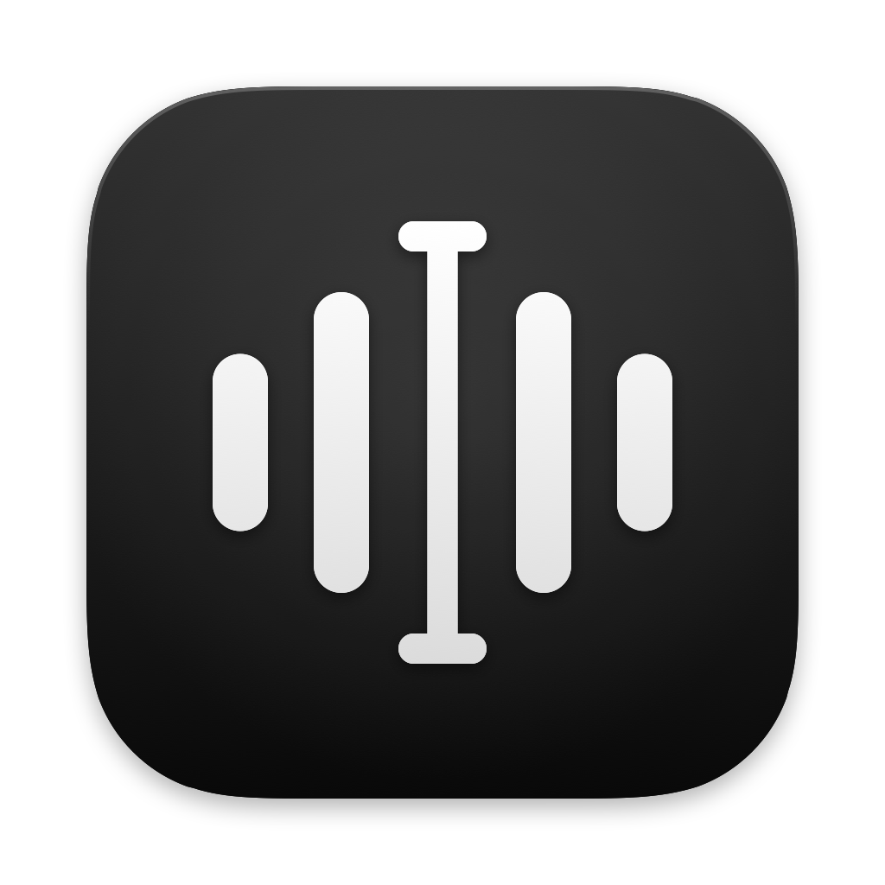

<p align="center">
  
</p>

<h1 align="center">TabTasker Dictate</h1>

<p align="center">
  <strong>Talk instead of typing, on your Mac.</strong><br>
  Hold a key, say it, and it’s written. In any app, and it never leaves your Mac.
</p>

<p align="center">
  
</p>

## What it is

TabTasker Dictate sits at the edge of your screen as a few quiet dots. Hold fn and talk: your words appear
where the cursor is, in your email, your chat, your code editor, anywhere. Let go and you’re done.

Point at the dots and they open into everything else: speak a note, write one, put a sticky on the screen,
record a meeting.

<p align="center">
  
</p>

## What you can do

- **Type with your voice, anywhere.** Every app, more than 40 languages, and “send” presses Return for you.
- **Take notes by talking.** Talk for as long as you like. The note is saved as a plain Markdown file in
  your Documents folder, ready to edit with headings, to-dos, tables and pictures.
- **Keep stickies on top.** Small notes that float over your other windows. Say “sticky: call Thomas”
  while you dictate and one appears.
- **Record meetings.** The room and the other side of a call, transcribed as it goes, with every voice
  told apart.
- **Add AI if you want it.** Connect Claude, or a model running on your own Mac, and it titles your notes,
  summarises meetings, tidies what you dictate and follows spoken commands.

<p align="center">
  
</p>

## Private by design

Your voice is turned into text by Whisper, running on your Mac’s own chip. No audio is ever uploaded.
There’s no account and nothing to sign in to. If you connect a model, it only ever sees text, and you can
see exactly what it gets in Settings.

## Get started

You need a Mac with Apple silicon and macOS 13 or later. On first launch the app downloads its speech model
once (about 875 MB) and walks you through the microphone and Accessibility permissions.

To build it yourself, with Rust, Node 22 and Xcode’s command line tools installed:

```sh
npm install
npm run tauri dev      # run from source
npm run tauri build    # TabTasker Dictate.app and a DMG in src-tauri/target/release/bundle
```

How it all works is written up in [docs/spec/v1.md](docs/spec/v1.md).

## License

Apache-2.0, see [LICENSE](LICENSE). The speech models and libraries it uses are listed with their licenses
in [THIRD_PARTY_NOTICES.txt](THIRD_PARTY_NOTICES.txt).
