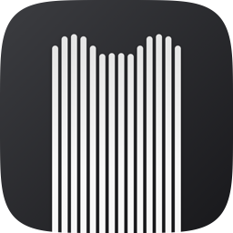
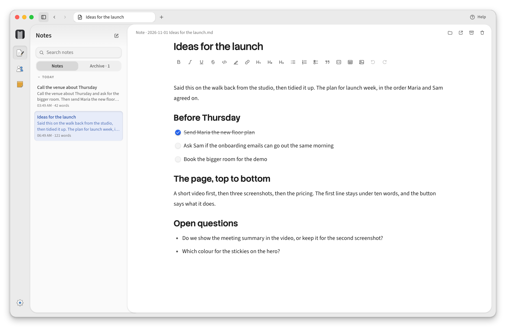
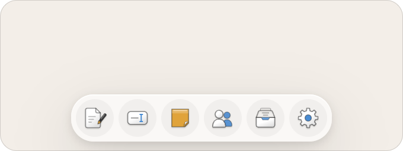
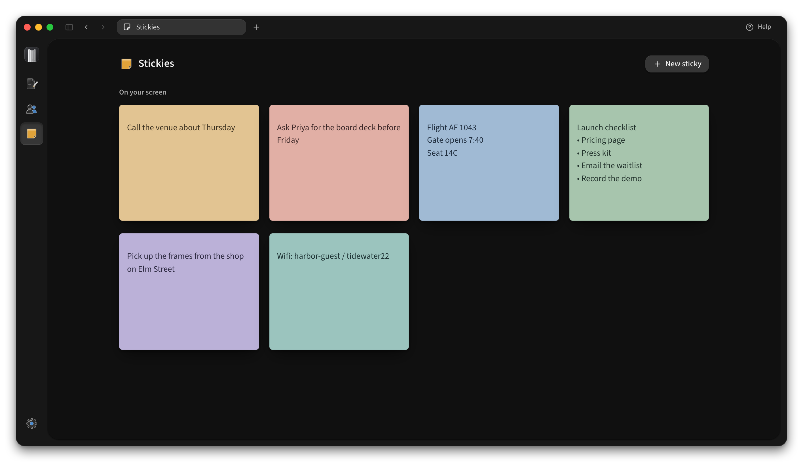

<p align="center">
  
</p>

<h1 align="center">TabTasker Dictate</h1>

<p align="center">
  <strong>Talk, and it’s typed.</strong><br>
  Hold fn in any app, say what you want to write, and let go.
</p>

<p align="center">
  
</p>

Dictate lives in a few small dots at the edge of your screen. Wherever your cursor is, hold your key and
talk, and your words are typed in when you let go. The dots open up for everything else: a note you can
talk into for as long as you like, a sticky that stays on top of your windows, or a meeting recording.

<p align="center">
  
</p>

## What’s in it

- Dictation in any app, in more than 40 languages. Say “send” at the end and it presses Return for you.
- Notes you can talk or type. They’re plain Markdown files in your Documents folder, so Obsidian and
  everything else can read them.
- Stickies that float over your windows until you close them. Say “sticky: call Thomas” while you dictate
  and one appears.
- Meeting recordings that tell the voices apart, including the other side of a call.
- AI if you want it. Connect Claude or a model running on your Mac, and it’ll name your notes, summarise
  your meetings and tidy up what you dictate.

<p align="center">
  
</p>

## Privacy

Speech recognition runs on your Mac, so your voice never leaves it and you don’t need an account. If you
connect an AI model, it only ever gets text, and Settings shows you exactly what it sees.

## Get started

You’ll need a Mac with Apple silicon on macOS 13 or later. The first time it opens, Dictate downloads its
speech model (about 875 MB) and walks you through the two permissions it needs.

To build it yourself, install Rust, Node 22 and Xcode’s command line tools, then:

```sh
npm install
npm run tauri dev      # run from source
npm run tauri build    # TabTasker Dictate.app and a DMG in src-tauri/target/release/bundle
```

The full design is written up in [docs/spec/v1.md](docs/spec/v1.md).

## License

Apache-2.0, see [LICENSE](LICENSE). The speech models and libraries it uses are listed with their licenses
in [THIRD_PARTY_NOTICES.txt](THIRD_PARTY_NOTICES.txt).
