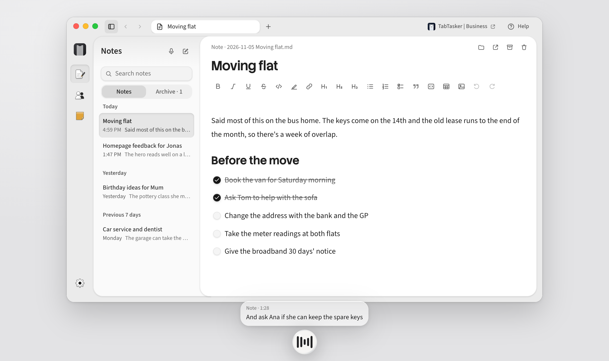
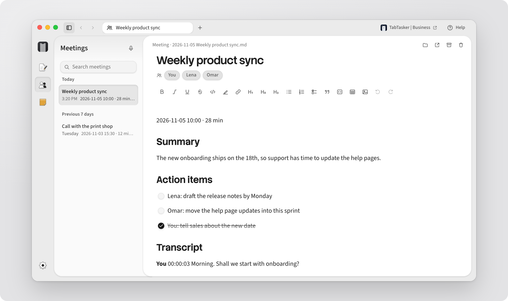
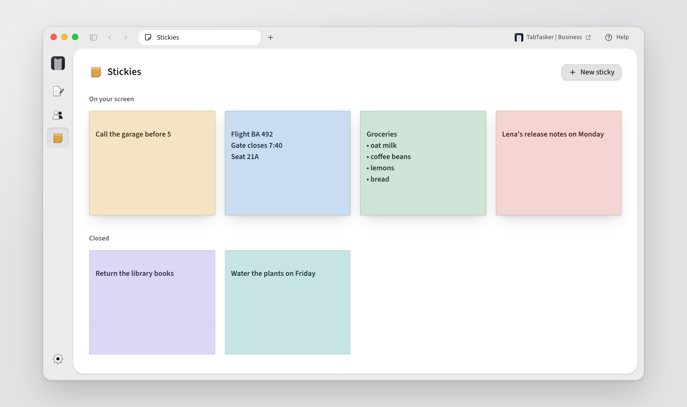

<p align="center">
  
</p>

<h1 align="center">TabTasker | Dictate</h1>

<p align="center">
  <strong>Talk, and it’s typed.</strong><br>
  Hold fn in any app, say what you want to write, and let go.
</p>

<p align="center">
  <a href="https://github.com/vehicularis/tabtasker-dictate/releases/latest"><strong>Download for Mac</strong></a><br>
  For Apple silicon, on macOS 13 or later
</p>

<p align="center">
  <a href="https://github.com/vehicularis/tabtasker-dictate/actions/workflows/ci.yml"></a>
  <a href="https://github.com/vehicularis/tabtasker-dictate/releases/latest"></a>
  
  <a href="LICENSE"></a>
</p>

<p align="center">
  <picture>
    <source media="(prefers-color-scheme: dark)" srcset="docs/images/notes-dark.png">
    
  </picture>
</p>

Dictate lives in a thin pill at the edge of your screen. Wherever your cursor is, hold your key and talk.
Your words appear as you say them, and the finished text takes their place when you let go. The pill opens
up for everything else: a note you can talk into for as long as you like, a sticky that stays on top of your
windows, or a meeting recording.

## What’s in it

- Dictation in any app, in more than 40 languages. Say “send” at the end and it presses Return for you.
- Notes you can talk or type. They’re plain Markdown files in your Documents folder, so Obsidian and
  everything else can read them.
- Meeting recordings that tell the voices apart, including the other side of a call.
- Stickies that float over your windows until you close them. Say “sticky: call Thomas” while you dictate
  and one appears.
- AI if you want it. Connect Claude, OpenAI or any service that speaks the OpenAI API, or a model running
  on your Mac, and it’ll name your notes, summarise your meetings and tidy up what you dictate.

<p align="center">
  <picture>
    <source media="(prefers-color-scheme: dark)" srcset="docs/images/meeting-dark.png">
    
  </picture>
</p>

<p align="center">
  <picture>
    <source media="(prefers-color-scheme: dark)" srcset="docs/images/stickies-dark.png">
    
  </picture>
</p>

## Privacy

Speech recognition runs on your Mac, so your voice never leaves it and you don’t need an account. If you
connect an AI model, it only ever gets text, and Settings shows you exactly what it sees.

## Install

Download the DMG from the [latest release](https://github.com/vehicularis/tabtasker-dictate/releases/latest), open it
and drag TabTasker Dictate into Applications. You’ll need a Mac with Apple silicon on macOS 13 or later, and
macOS 14.2 or later to record the other side of a call. The first time it opens, Dictate downloads its speech
model (about 875 MB) and walks you through the two permissions it needs.

It’s signed by Vehicularis Limited and notarized by Apple, so it opens without a warning. Each release is built
in the open, by this repository’s [release workflow](.github/workflows/release.yml) from a tagged commit on main.
To check a download yourself, compare its SHA-256 with the release’s SHA256SUMS file, ask Gatekeeper, and ask
GitHub whether that workflow built it (with the [GitHub CLI](https://cli.github.com), signed in):

```sh
shasum -a 256 ~/Downloads/TabTasker-Dictate-*-arm64.dmg
spctl -a -vv -t install ~/Downloads/TabTasker-Dictate-*-arm64.dmg    # accepted, source=Notarized Developer ID
gh attestation verify ~/Downloads/TabTasker-Dictate-*-arm64.dmg -R vehicularis/tabtasker-dictate
```

0.1.0 and 0.1.1 were built on a Mac before the workflow, so they have no attestation.

Dictate updates itself. Every few hours it looks for a new release, downloads it in the background, checks
it’s signed by us, and offers to restart. It never restarts while you’re dictating or recording a meeting.
Turn that off, or check now, in Settings › General; the pill’s menu has Check for updates… too. Your settings,
notes and speech model stay where they are. 0.1.1 and earlier can’t update themselves: download the newest
release once and replace the app. What changed in each release is in [CHANGELOG.md](CHANGELOG.md).

## Questions

### Pressing fn opens the emoji picker

While fn is your dictate key, Dictate sets the 🌐 key to do nothing, and puts your own setting back when it
quits. To keep the 🌐 key’s action, choose another dictate key in Settings › Shortcuts.

### It hears me, but nothing is typed

Dictate types through Accessibility. In System Settings › Privacy & Security › Accessibility, check that
TabTasker Dictate is switched on. If it is and nothing is typed, remove it with the minus button, add it again
and open Dictate again.

### Does it work without the internet?

Yes. Once the speech model has downloaded, dictation, notes, stickies and meetings all work offline. Only an
AI service you connect needs the internet, and a model running on your Mac doesn’t.

### Does it run on an Intel Mac?

No. Dictate is built for Apple silicon, where Whisper runs on the Mac’s GPU.

### Where are my notes?

In Documents › TabTasker Dictate, as plain Markdown files. You can choose another folder, an Obsidian vault
for example, in Settings › Notes.

## Uninstall

Quit Dictate (Quit TabTasker | Dictate is at the bottom of the pill’s menu) and move it from Applications to
the Trash. Its settings, history, stickies and speech model are in
`~/Library/Application Support/com.tabtasker.dictate`, and its log is in `~/Library/Logs/TabTasker Dictate`.
Delete those folders to remove them too. Your notes stay in your Documents folder. If you connected an AI
service, its key is in Keychain Access under `com.tabtasker.dictate`.

## Build from source

Install Rust, Node 24 and Xcode’s command line tools, then:

```sh
npm install
npm run tauri dev      # run from source
npm run tauri build -- --no-sign    # an unsigned TabTasker Dictate.app and DMG in src-tauri/target/release/bundle
```

A release, signed with the Developer ID, notarized and stapled, comes from
[scripts/release-mac.sh](scripts/release-mac.sh), which the [release workflow](.github/workflows/release.yml)
runs for a pushed tag. CONTRIBUTING.md says how to make one.

## Contributing

Bug reports, ideas and pull requests are welcome. [CONTRIBUTING.md](CONTRIBUTING.md) says how to build Dictate
and what a pull request needs. Report a security problem privately, as [SECURITY.md](SECURITY.md) explains.

## License

Apache-2.0, see [LICENSE](LICENSE) and [NOTICE](NOTICE). The speech models and libraries it uses are listed
with their licenses in [THIRD_PARTY_NOTICES.txt](THIRD_PARTY_NOTICES.txt).
