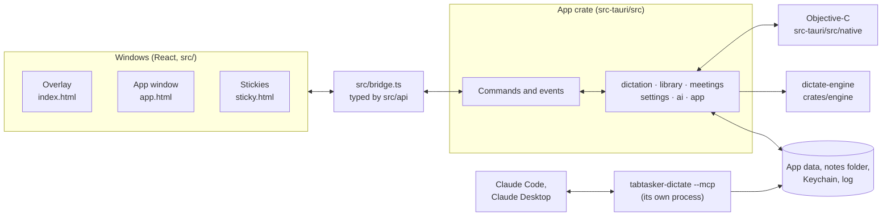

# How TabTasker Dictate fits together

This is the map: what each part owns, how a dictation travels through them, and where things are kept.
[AGENTS.md](../AGENTS.md) has the rules for changing them. File names are relative to the repository root,
and the code is the authority wherever this page and it disagree.

## The parts

- **Three kinds of window.** All are made in Rust (`src-tauri/src/app/windows.rs`, `library/stickies.rs`);
  `tauri.conf.json` declares none.
  - `overlay` (`index.html`): the dots and pill over every screen, the orb while you talk, and the cards.
  - `main` (`app.html`): notes, meetings, stickies, settings and setup, in tabs.
  - `sticky-<id>` (`sticky.html?id=<id>`): one per sticky.

  Each window has a capabilities file in `src-tauri/capabilities/`.
- **The app crate** (`src-tauri`, lib `dictate_lib`) owns everything that isn't speech: commands, windows,
  menus, settings, history, notes, stickies, meetings, Claude, updates. Its modules are listed below.
- **The native code** (`src-tauri/src/native/*.m`) owns what only AppKit can do:
  - the dictate key, the microphone and its audio buffer;
  - typing into other apps;
  - the overlay's blur, click-through and Dock avoidance;
  - meeting audio from the microphone and the Mac's sound;
  - the Keychain.

  `build.rs` compiles every `.m` there into one static library.
- **The engine** (`crates/engine`) turns samples into text and knows nothing of the app. The lab
  (`crates/lab`) drives the same engine from the command line.
- **The MCP server** is the same binary started with `--mcp` (`src-tauri/src/main.rs`). Claude Code or
  Claude Desktop starts it as a separate process. It reads the notes folder and settings itself, and never
  starts the microphone or a model.

## A dictation, end to end

1. **The key goes down.** `dictate.m` watches the keyboard with `NSEvent` local and global monitors.
   - Key codes, taps and chords are pure C in `keys.m`, tested from `src-tauri/tests/keys.rs`.
   - Every window hears `dictate-fn`.
   - The microphone opens at once for fn, so the first word isn't cut. With a right-hand modifier as the
     key it waits 120 ms, so shortcuts don't flash the microphone indicator.
   - The hold itself begins 0.18 s later (0.25 s with hands-free on), so a tap never records.
2. **The hold begins** (`begin` in `dictate.m`). It notes the app in front and tells Rust through
   `dictate_hold_begin` (`dictation/context.rs`), which keeps the last 16 holds' context.
3. **Audio is buffered.**
   - An AVAudioEngine tap feeds `TTVoiceAudio`, which converts to 16 kHz mono floats.
   - A hold can last 5 minutes, or 10 hands-free.
   - The overlay gets `dictate-state` with the level 30 times a second.
4. **A live pass runs while you talk.** Every 0.2 s native code lends the buffer to `dictate_draft`
   (`dictation/speech.rs`), which runs a quick greedy pass.
   - The orb shows the words (`dictate-said`, `live: true`).
   - Once two passes agree, the words are typed into the field as you go (`typeLive:` in `dictate.m`,
     `TTInsertEdit` in `insert.m`).
   - Live typing is skipped in notes, commands and password fields.
5. **The key comes up.** `finish` waits for a short tail (about 0.3 s), stops the microphone and calls
   `dictate_audio`. Rust copies the samples, and writes them to `unsent/` in the app's data, so a crash
   doesn't lose them. Then it runs the final pass on a blocking task.
6. **The final pass.** `finish` in `speech.rs` runs the engine's gate first (`vad.rs`, `audio.rs`): too
   quiet, no voice, or speech ending at a time.
   - If the live pass already heard everything to the speech's end, its words are used and the pass is
     skipped.
   - A hold longer than one piece goes the voice note's way instead (below).
   - Otherwise `pass` hears it:
     - **The language** (`pipeline.rs`): pinned in Settings, else held from an earlier pass of this hold,
       else detected (kept only when at least 0.9 sure).
     - **Whisper** (`whisper.rs`): beam search with the vocabulary as a prompt. It hears again without the
       prompt if Whisper only recited the vocabulary, and drops silent and looping segments.
7. **Finishing the text** (`settle` in `speech.rs`):
   - the text rules (`text/` in the engine): replacements, fillers, and each app's style (Default, Casual,
     Formal, Code, Raw);
   - Claude's polish, if it's on for that app (6 s at most, see `ai/`);
   - a line in the history.
8. **Spoken commands.** "Sticky …" at the start makes a sticky and types nothing (`stickies::from_voice`).
   "Send" at the end, or a chat app set to send, presses Return after typing. Both apply only when
   dictating or hands-free, never in a note or a command.
9. **Typing.** Back on the main thread, `dictate_result` hands the text to `receiveText` in `dictate.m`.
   `insert.m` pastes it with the clipboard saved and restored, or types it key by key where pasting
   doesn't work. Without Accessibility, the text goes to the clipboard instead.
10. **Learning** (`learn.m`). For 30 s it watches the field for a correction you make by hand. Rust decides
    whether it's one (`dictation/text.rs`), and a hit becomes a vocabulary suggestion and a `dictate-learned`
    card.

All inference runs one pass at a time, behind the single engine mutex in `LocalSpeech`.

### Voice notes and hands-free

A note (the pill's note button, or its shortcut) records until you stop it, or until 3 minutes of silence.
- While you talk, `dictate_note_step` (`dictation/speech_note.rs`) asks speech detection for the pauses.
  `pieces::cut` in the engine picks one past 6 s, and that piece is heard for good while you keep talking.
  Native code then frees the audio already heard.
- At the end, `pieces::hear_long` hears whatever is left, and the overlay shows the note (`dictate-note`)
  to review and save.
- `save_note` (`library/notes.rs`) writes the Markdown file, asking Claude for a title and action items
  when it's on.
- Hands-free (a double tap of fn) and holds longer than one piece take the same piece-by-piece path.

### Meetings

1. **Starting.** A meeting starts from the pill, the menu bar or its shortcut. `meeting_audio.m` records
   the microphone, and the Mac's sound if Settings asks for it, through a CoreAudio process tap.
2. **Recording.** Rust (`meetings/mod.rs`) spools both streams to disk in `meetings/<start>/` in the app's
   data, as `mic.pcm` and `system.pcm`. A `meeting` thread transcribes them while you talk:
   - every 700 ms it cuts at a pause and skips silence;
   - it calls `speech::transcribe_piece`, which waits whenever a dictation needs the engine;
   - it appends each piece to `pieces.jsonl`.
3. **Saving.** After the stop, the thread drains what's left. It can then:
   - tell the speakers apart (the engine's `meeting::speakers`, with two downloaded models);
   - ask Claude for a summary and a title.

   Finally it writes the transcript as a Markdown note in the meetings folder.
4. **Leftovers.** A meeting that a quit or crash interrupted is offered again on the next launch
   (`meeting_recover`).

## Between Rust and Objective-C

Everything the app sends across is a C function named `dictate_*`. Only the `tt_*` key logic in `keys.m`,
which the Rust tests call directly, is named otherwise.

| Direction | Where | What |
|---|---|---|
| Rust calls native | `extern "C"` blocks in `app/mod.rs`, `lib.rs`, `settings.rs`, `dictation/*.rs`, `ai/mod.rs`, `library/*.rs`, `meetings/mod.rs` | Start, settings, status and permissions; results and live typing; the overlay's layout; meeting audio; the Keychain; the folder picker; the apps list |
| Native calls Rust | `#[no_mangle] extern "C"` in `app/events.rs` (`dictate_ui_*`, `dictate_log`, `dictate_cancel`), `dictation/speech.rs`, `speech_note.rs`, `context.rs`, `text.rs`, `ai/mod.rs`, `meetings/mod.rs` | Events for the windows; audio for a pass or a note step; corrections and learned words; spoken commands; meeting audio and its start and end |

Native code lends its audio buffer, and Rust copies it before the call returns. Results go back through
`run_on_main_thread`. The page tells the overlay which parts are glass and which take clicks through the
`layout` command. The overlay window is shown only after the page's first layout report.

## Threads and shared state

- **The main thread** runs AppKit and all the voice state, including the level, draft, overlay and sticky
  timers.
- **Serial queues** (`com.tabtasker.voice.audio`, `com.tabtasker.dictate.live`, `com.tabtasker.meeting.*`)
  start and stop audio, and type live edits in order.
- **Tauri's async runtime** runs every pass on a blocking task (`spawn_blocking`). It also runs model
  downloads and loading, Claude calls and file commands.
- **Long-lived threads:**
  - `meeting`, one per recording;
  - `notes-watch`, which rescans the notes folder every 4 s for the menu bar's recent notes;
  - an hourly history prune;
  - the update watcher, one minute after launch and then every 6 hours, never in a debug build.
  - In the `--mcp` process, a watcher re-reads Settings every 2 s and tells the agent when its tools change.
- **State** lives in `LocalSpeech` (Tauri-managed: the engine, the speech detector, the job and the hold)
  and in module statics (`settings::CURRENT`, the history store, the meetings state, the update state).
  Every lock is poison-tolerant, and every pass runs under `catch_unwind`.

## The frontend

- **`src/bridge.ts`** is the only code that calls `window.__TAURI__`. Without it, in a plain browser, the
  bridge loads `src/mock/` instead. Its `invoke` and `listen` are typed
  by `src/api/commands.ts` and `src/api/events.ts`. Every type that crosses the bridge is in
  `src/api/types.ts`.
- **`src/mock/`** answers the same commands in a plain browser, so every window runs without the Mac side.
  Nothing it does leaves the page.
- **`src/lib/`** holds the rules as plain functions with tests. The components in `src/app/`,
  `src/overlay/`, `src/sticky/`, `src/editor/` and `src/onboarding/` render and wire them. `src/ui/` is
  the design system, and `src/store.ts` holds the shared settings and status hooks.

## What is kept where

| What | Where |
|---|---|
| Settings | `settings.json` in the app's data (`~/Library/Application Support/com.tabtasker.dictate/`), written whole through a temporary file. A damaged one is kept aside. |
| History | `history.jsonl` in the app's data, one line per dictation, command or note. The words are kept only as long as Settings › History says. |
| Speech models | `voice-models/` in the app's data, checked by size and SHA-256 (`crates/engine/src/models.rs`). |
| Unsent holds | `unsent/` in the app's data, removed once the words are out, recovered on the next launch otherwise. |
| Stickies | `stickies.json` in the app's data. |
| Meetings in progress | `meetings/<start>/` in the app's data, removed once saved unless audio is still unheard. |
| Notes | Markdown files in the notes folder (`~/Documents/TabTasker Dictate` unless changed), with front matter. They never overwrite a file. |
| Meeting transcripts | The meetings folder (`Meetings/` in the notes folder unless changed). |
| Note archive, attachments, deletes | Archived files go to `Archive/`, attachments to `attachments/<note>/`. A deleted file goes to the Trash. |
| Claude keys | The login Keychain, service `com.tabtasker.dictate`. |
| The log | `~/Library/Logs/TabTasker Dictate/dictate.log`, moved aside to `dictate.old.log` at launch once it passes 4 MiB. It keeps only this app's and the engine's lines, so Whisper's own logs, which can hold your words, never reach it. |

## Claude and the MCP server

**Claude is optional.** `src-tauri/src/ai/` sends text, never audio. It uses one of four routes:
- the Anthropic API, with a key in the Keychain;
- the person's own Claude Code;
- a local server;
- an OpenAI-compatible endpoint.

Claude polishes dictations, answers spoken commands on the command card, and writes note and meeting
summaries and titles. Whenever it doesn't answer, the person's own words are kept.

**`ai/mcp.rs` is an MCP server for other agents.** It speaks JSON-RPC over stdio. Its tools are listing,
reading and searching notes and meetings, recent dictations, and creating or appending to a note. Each
tool is gated by Settings › Agents. Reads stay inside the notes and meetings folders, and writes never
replace a note. The Agents page registers the server with Claude Code (`claude mcp add`) or Claude Desktop
(its config file, backed up first).

## Updates and releases

**Updates.** `app/updates.rs` checks the GitHub release marked Latest, through the updater plugin and
`latest.json`. It downloads a newer one in the background, checks its signature, and offers a restart, but
never during a hold, a note or a meeting.

**Releases.** A release is a tagged commit on `main`. [CONTRIBUTING.md](../CONTRIBUTING.md) has the steps.
The `release.yml` workflow:
1. runs `scripts/release-mac.sh`: Developer ID signing, notarization, the DMG, the signed update and
   `latest.json`;
2. attests where the DMG came from;
3. leaves a draft release for a person to publish.

## Tests and checks

| Where | What |
|---|---|
| `crates/engine/src/**` | The pipeline's rules, without models. A few `#[ignore]`d tests need models in `DICTATE_MODELS`. |
| `crates/lab/` | The lab's own tests, and `dictate-lab eval` over the spoken fixtures (CI's Speech eval). |
| `src-tauri/src/**` | Settings, history, notes, stickies, meetings, Claude, the MCP server, updates, the log. Some `#[ignore]`d speech tests need fixture folders. |
| `src-tauri/tests/` | `keys.rs` drives the key logic in `keys.m` with plain numbers. `mcp.rs` starts the real binary with `--mcp` and a scratch `HOME`. |
| `src/**/*.test.ts` | The frontend's rules, the contract against the Rust sources, and the mock. |

`npm run check` runs CI's checks except two: Dependency review, which only runs on GitHub, and the Speech eval.
`.github/workflows/` holds four workflows:
- `ci.yml`: security, dependency review, the frontend, and the macOS app;
- `speech-eval.yml`: the spoken fixtures, run when the speech code changes;
- `release.yml`: releases;
- `scorecard.yml`: OpenSSF Scorecard.
